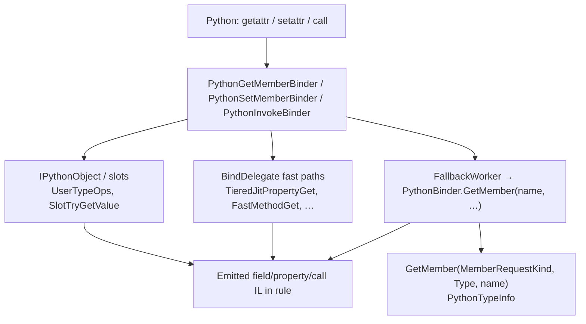

# CLR member access callback (IronPython design)

Design notes for registering a host callback that runs during Python execution and reports which CLR class and method, property, or field is being accessed, assigned, or called.

**Implementation tasks:** [clr-member-access-callback-tasks.md](./clr-member-access-callback-tasks.md)

## Summary

**`PythonBinder` is part of the story, but hooking it alone is not enough** for a callback that runs on every access at runtime. IronPython uses several parallel paths for member get, set, and call; only some of them go through the binder methods people usually mean.

---

## Two different `GetMember` APIs

`PythonBinder` inherits DLR `DefaultBinder` and already customizes CLR **member resolution** (names → `MemberGroup` / `PythonTypeSlot`):

- **Location:** `Src/IronPython/Runtime/Binding/PythonBinder.cs`
- **Method:** `GetMember(MemberRequestKind actionKind, Type type, string name)`

That runs during **binding** (and when building fast delegates), when IronPython asks which member exists on a CLR type. It does **not** run on every `obj.attr` at runtime once a call site is compiled.

The path that emits **runtime** code for `obj.foo` on plain CLR instances is DLR `DefaultBinder.GetMember(string name, DynamicMetaObject target, …)`, reached from `PythonGetMemberBinder.FallbackWorker`:

- **Location:** `Src/IronPython/Runtime/Binding/PythonGetMemberBinder.cs` → `context.Binder.GetMember(name, self, resolverFactory, …)`

| API | Role | Fires per runtime access? |
|-----|------|---------------------------|
| `GetMember(MemberRequestKind, Type, string)` | Resolve metadata / slots | No (bind-time + cache) |
| `GetMember(name, target, …)` / `SetMember` / `Call` | Build expression trees for dynamic sites | Yes, in the **compiled rule** for that site |

For this feature, **`PythonBinder` overrides or wrappers around the string-based `GetMember` / `SetMember` / `Call` (and invoke binding)** are the right DLR-aligned place—but additional hooks are still required (see below).

DLR implementation references:

- `Src/DLR/Src/Microsoft.Dynamic/Actions/DefaultBinder.GetMember.cs`
- `Src/DLR/Src/Microsoft.Dynamic/Actions/DefaultBinder.SetMember.cs`
- `Src/DLR/Src/Microsoft.Dynamic/Actions/DefaultBinder.Invoke.cs`

---

## End-to-end flow (simplified)

Anything that only hooks `GetMember(MemberRequestKind, …)` misses fast delegates and many slot/reflection paths.

---

## Where runtime work actually happens

### 1. DLR slow path (plain .NET objects)

`DefaultBinder.GetMember` / `SetMember` / `Call` build `DynamicMetaObject` expression trees. `PythonBinder.ReturnMemberTracker` turns many trackers into constants or call expressions (methods as `BuiltinFunction`, fields, properties, etc.).

### 2. IronPython fast paths

`PythonGetMemberBinder.MakeGetMemberTarget` compiles tight delegates (e.g. direct property getters) that **never** call back into `PythonBinder` at runtime.

### 3. PythonTypeSlot / reflected members

- Gets often go through `PythonOps.SlotTryGetValue`
- Sets through `PythonOps.SlotTrySetValue`
- Fields also use `ReflectedField.DoSet` (uses `PerfTrack` today, not a host callback)
- Properties use `ReflectedProperty.CallGetter` → `BuiltinFunction.Call0`

### 4. Method calls

Bound CLR methods flow through `PythonInvokeBinder` → `PythonBinder.Call` / `CallMethod`, `MetaBuiltinMethodDescriptor`, and `BuiltinFunction` call sites—not through metadata `GetMember`.

### 5. Pure Python objects

`MetaUserObject`, `UserTypeOps`, etc. use Python’s own model (`PythonType`, descriptors). A callback shaped as “class + method/property/field” is **CLR-focused**. Covering pure-Python attributes is a separate layer (`__getattribute__` / tracing), not `PythonBinder`.

---

## Recommended design

### 1. Registration surface (host)

Mirror `SetTrace` / listeners on `PythonContext`:

- Register **before** running scripts when possible.
- Document that **already-bound dynamic sites stay cached** until those code paths rebind (same class of issue as tracing toggling, but for call sites rather than `FunctionCode`).

Suggested API shape:

- **`ClrMemberAccessKind`:** Get, Set, Call (Delete deferred — see locked decisions).
- **`ClrMemberKind`:** Method, Property, Field, Event.
- **Payload:** declaring `Type`, `MemberInfo` (or specific method/property/field), optional `instance`, optional `name` when overload resolution is ambiguous on Call.

Keep the callback on **`PythonContext`** (or `IronPython.Hosting.Python`) and dispatch from **`PythonOps`** static helpers so emitted expression trees can call one stable method.

### 2. Primary hook: wrap `PythonBinder` DLR binding methods

In `PythonBinder`, override or wrap after `base`:

- `GetMember(string, DynamicMetaObject, OverloadResolverFactory, …)`
- `SetMember(…)`
- `Call` / `CallMethod` when `BindingTarget` resolves to a specific `MethodBase`

When a listener is active, wrap the returned `Expression` in a block that invokes something like:

`PythonOps.NotifyClrMemberAccess(codeContext, kind, memberInfo, instanceExpr)`

**before** the real get/set/call. That yields **per-invocation** behavior for slow-path rules.

A small DLR extension (virtual hook on `DefaultBinder`, or passing `MemberTracker` into a Python-specific wrapper) can make member-aware wrapping cleaner than inferring from name alone after the fact. **v1 uses re-resolve in `PythonBinder` only (no DLR delta).**

### 3. Secondary hooks (required for completeness)

| Gap | Mitigation |
|-----|------------|
| Fast get/set delegates | **Interim (Task 3):** when a listener is registered, `BindDelegate` skips fast paths and uses slow DLR binding + `PythonBinder` notify wrappers. **Task 7:** keep that policy or inject notify into `TieredJitPropertyGet` / `FastMethodGet` (Option B) and re-enable fast paths. |
| `SlotTryGetValue` / `SlotTrySetValue` | Notify in `PythonOps` when the slot is `ReflectedField` / `ReflectedProperty` / `BuiltinMethodDescriptor` |
| `ReflectedField.DoSet`, property getters | Notify at start of `TryGetValue` / `TrySetValue` / `CallGetter` for reflected types |
| Extension methods | `PythonExtensionBinder.GetMember`; same notify when bound |
| COM / `IDynamicMetaObjectProvider` | Separate foreign-object binders unless v1 explicitly scopes to non-COM CLR |

`GetMember(MemberRequestKind, Type, string)` remains useful to **enrich** callbacks during binding; it should not be the **only** hook.

### 4. Semantics: what “class” means in callbacks

Be explicit in the API:

- **Declaring type** (`MemberInfo.DeclaringType`) vs **runtime type** of `instance`
- **Static** vs instance (`instance` may be null)
- **Get that returns a method** vs **Call**—typically fire Get when the descriptor is retrieved and Call when arguments are passed (CPython-style separation)

### 5. Tests

Extend patterns in `IronPythonTest/BinderTest.cs` and existing binder/interop tests:

- Register callback
- Run short Python against known types (`CNoOverloads`, fields, properties)
- Assert ordering and member identity

---

## Locked product decisions (v1)

Recorded for Task 0 — change only via explicit scope revision.

| # | Decision | v1 choice |
|---|----------|-----------|
| 0.1 | Scope | **CLR only** — not Python user types (`MetaUserObject`, etc.) |
| 0.2 | Method descriptor vs invoke | **Both** — fire **Get** when a bound member is retrieved (including method descriptors), **Call** when invoked |
| 0.3 | Mid-run registration | **No** — register before execute; already-bound dynamic sites stay cached (document for hosts; no generation counter in v1) |
| 0.4 | Delete vs Event in model | **Delete** member notifications **deferred** (`ClrMemberAccessKind`: Get, Set, Call only). **`ClrMemberKind` includes Event** (Method, Property, Field, Event). |
| 0.5 | COM / `IDynamicMetaObjectProvider` | **Out of scope** for v1 |

---

## Conclusion

- **`PythonBinder` is the right hub for CLR interop binding**, especially overrides of DLR **`GetMember` / `SetMember` / `Call`** (not only `GetMember(MemberRequestKind, …)`).
- A complete feature also needs **`PythonGetMemberBinder` fast-path policy**, **`PythonOps` slot/reflection entry points**, and a clear **`PythonContext` registration API**.
- An optional **DLR** tweak in `DefaultBinder` makes member-aware wrapping cleaner than inferring from name alone after the fact.
