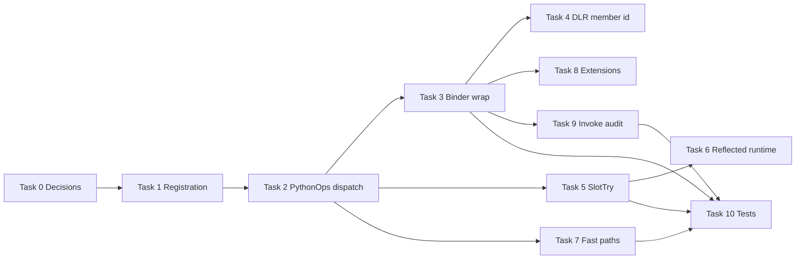

# CLR member access callback — development tasks

Implementation breakdown for [clr-member-access-callback-design.md](./clr-member-access-callback-design.md).

**Suggested order:** complete Task 0 before coding; then Task 1 → 2 → 3, then parallelize 4–8 as needed; Task 9 validates end-to-end; Task 10 is optional follow-up.

---

## Task 0 — Lock product decisions ✅

**Goal:** Fix v1 scope so later tasks do not rework APIs or semantics.

**Locked (see design doc):**

| # | v1 choice |
|---|-----------|
| 0.1 | **CLR only** |
| 0.2 | **Get + Call** for methods |
| 0.3 | Register before execute; cached sites not invalidated mid-run |
| 0.4 | **Delete** notifications deferred; **`ClrMemberKind` includes Event** |
| 0.5 | COM / `IDynamicMetaObjectProvider` out of scope |

**Done when:** Decisions written; no open blockers for Task 1 API shape. → [clr-member-access-callback-design.md](./clr-member-access-callback-design.md) **Locked product decisions (v1)**.

---

## Task 1 — Registration surface (host API) ✅

**Goal:** Host can register and clear a callback; runtime can ask whether notifications are enabled (for fast-path gating later).

**Depends on:** Task 0

**Deliverables:**

- Public types in `IronPython.Runtime` (`ClrMemberAccess.cs`):
  - `ClrMemberAccessKind` — `Get`, `Set`, `Call`
  - `ClrMemberKind` — `Method`, `Property`, `Field`, `Event`
  - `ClrMemberAccessEventArgs`, `ClrMemberAccessEventHandler`
- **`PythonContext`:** `SetClrMemberAccessListener`, `HasClrMemberAccessListener`, internal `NotifyClrMemberAccess`
- **`IronPython.Hosting.Python`:** `SetClrMemberAccessListener` on `ScriptEngine` / `ScriptRuntime`
- Tests: `IronPythonTest/ClrMemberAccessRegistrationTest.cs`

**Not in scope:** Emitting notifications from real Python/CLR access yet (Task 2).

---

## Task 2 — Central dispatch (`PythonOps`) ✅

**Goal:** Single runtime entry point callable from expression trees and reflection paths.

**Depends on:** Task 1

**Deliverables:**

- `PythonOps.ClrMemberAccess.cs`: `NotifyClrMemberAccess` overloads (args, `MemberInfo`, `MemberTracker`, `PythonTypeSlot`); fast no-op when no listener
- `CreateClrMemberAccessEventArgs` / `TryCreateClrMemberAccessEventArgs`; host callback exceptions propagate (documented)
- Tests: `IronPythonTest/ClrMemberAccessDispatchTest.cs`

---

## Task 3 — DLR slow path: `PythonBinder` get / set / call wrapping ✅

**Goal:** When listener is active, slow-path dynamic rules notify before member get, set, or call on CLR objects.

**Depends on:** Task 2

**Deliverables:**

- `PythonBinder.ClrMemberAccess.cs`: hide `GetMember` / `SetMember` / `Call` / `CallMethod`; prepend `NotifyClrMemberAccess` on success (skip errors, Python types, unmapped members; single-method `MethodGroup` only on get)
- `PythonGetMemberBinder` / `PythonSetMemberBinder`: skip `BindDelegate` fast paths when listener registered
- Tests: `IronPythonTest/ClrMemberAccessSlowPathTest.cs` (`ClrMemberAccessProbe`)

**Interim (until Task 7):** With a listener registered, get/set **always fall back to slow DLR binding** (fast `BindDelegate` paths are skipped). This guarantees notify coverage but is **not** the long-term performance story — Task 7 will either inject notify into fast delegates or document skipping as permanent policy.

**Note:** Ambiguous overloads on get still skip notify; Task 4 / Task 9 can refine call identity.

---

## Task 4 — DLR helper: member identity at bind time (deferred)

**Goal:** Avoid guessing member from name string when wrapping expressions.

**Decision:** **No DLR changes.** Task 3 **`ResolveMemberTracker`** re-resolves via `GetMember(MemberRequestKind, Type, name)` after `base.GetMember` / `SetMember` (same heuristics as DefaultBinder member picking, but not guaranteed identical in all edge cases).

**If needed later:** virtual `AdaptBoundMember*` hooks on `DefaultBinder` (upstream DLR diff) or expression-tree mining in IronPython only.

**Tests:** `ClrMemberAccessTrackerBindingTest` checks re-resolve on `new`-hidden field (best-effort, not bind-time tracker proof).

---

## Task 5 — Slot path: `SlotTryGetValue` / `SlotTrySetValue`

**Goal:** Reflected members reached via `PythonTypeSlot` and emitted `SlotTry*` calls notify at runtime.

**Depends on:** Task 2

**Deliverables:**

- In `PythonOps.SlotTryGetValue` / `SlotTrySetValue` (and `SlotTryDeleteValue` if Delete in scope): after successful slot dispatch, if slot is `ReflectedField`, `ReflectedProperty`, or relevant descriptor, call `NotifyClrMemberAccess`

**Key files:**

- `Src/IronPython/Runtime/Operations/PythonOps.cs`
- `Src/IronPython/Runtime/Types/ReflectedField.cs`, `ReflectedProperty.cs`

**Acceptance criteria:**

- Python access that compiles to slot path still fires callback (may overlap Task 3 — ensure no **double** notify; pick one path per access or idempotent host contract)

**Note:** Coordinate with Task 3 to avoid duplicate events for the same operation.

---

## Task 6 — Reflected get/set runtime (non-emitted)

**Goal:** Cover `TryGetValue` / `TrySetValue` / `CallGetter` / `DoSet` when binding did not inline access.

**Depends on:** Task 2, Task 5 (dedupe strategy)

**Deliverables:**

- Notify at start of successful operations in:
  - `ReflectedField` (`TryGetValue`, `DoSet` / `TrySetValue`)
  - `ReflectedProperty` (`CallGetter`, setters)
- Prefer single choke point if Task 5 already covers all slot entry — only fill gaps

**Acceptance criteria:**

- Scenarios that use reflection fallback (non-public members, generic parameters, etc.) still notify

---

## Task 7 — Fast-path policy (`PythonGetMemberBinder` / `PythonSetMemberBinder`)

**Goal:** Listener registered ⇒ fast delegates either notify or are skipped so behavior matches slow path.

**Depends on:** Task 1 (`HasClrMemberAccessListener`), Task 2

**Status:** Task 3 already applies **Option A** (force slow bind when listener is on). Task 7 is to **finalize** that choice vs Option B and document the performance tradeoff — not to leave “temporary slow-only” undocumented.

**Deliverables:**

- When listener active:
  - **Option A (simpler):** `BindDelegate` skips fast paths, fall back to slow binding (may re-use Task 3 wrappers), **or**
  - **Option B (faster):** inject `NotifyClrMemberAccess` into `TieredJitPropertyGet`, `FastMethodGet`, etc.
- Document performance tradeoff

**Key files:**

- `Src/IronPython/Runtime/Binding/PythonGetMemberBinder.cs`
- `Src/IronPython/Runtime/Binding/PythonSetMemberBinder.cs`

**Acceptance criteria:**

- With listener on, property get and method get fast paths fire exactly one notification per access (same as slow path tests)

---

## Task 8 — Extension methods

**Goal:** CLR extension method get/call surfaces in callback.

**Depends on:** Task 3 or Task 7

**Deliverables:**

- Hook when `PythonExtensionBinder` / module extension binder resolves member or call (mirror main binder wrapping or shared helper)

**Key files:**

- `Src/IronPython/Runtime/Binding/PythonExtensionBinder.cs`
- `PythonGetMemberBinder.FallbackWorker` extension fallback

**Acceptance criteria:**

- Test with extension method on a type in `IronPythonTest` (add minimal extension if none exists)

---

## Task 9 — Invoke-only paths (`BuiltinFunction`, `MetaBuiltinMethodDescriptor`)

**Goal:** Method **Call** always notifies even when Get did not run (e.g. bound method invoked directly).

**Depends on:** Task 3, Task 2

**Deliverables:**

- Audit: `PythonInvokeBinder` → `CallMethod`, `MetaBuiltinMethodDescriptor.InvokeWorker`, `BuiltinFunction.Call*`
- Add `NotifyClrMemberAccess(..., Call, ...)` where Task 3 `Call` wrap does not run
- Align with Task 0.2 (Get vs Call semantics)

**Key files:**

- `Src/IronPython/Runtime/Binding/PythonInvokeBinder.cs`
- `Src/IronPython/Runtime/Binding/MetaBuiltinMethodDescriptor.cs`
- `Src/IronPython/Runtime/Types/BuiltinFunction.cs`

**Acceptance criteria:**

- `obj.method()` and `obj.method` then `()` produce expected event sequence per Task 0.2

---

## Task 10 — Integration tests and documentation

**Goal:** Regressions caught; host developers know how to use the API.

**Depends on:** Tasks 3, 5–7 minimum for “complete v1”

**Deliverables:**

- Tests in `IronPythonTest` (C# host + Python snippet, or existing test harness):
  - Field get/set
  - Property get/set
  - Instance and static method call
  - Listener register/unregister
- Update `.cursor/plans/clr-member-access-callback-design.md` with final API names and dedupe rules
- Short comment in registration API XML docs referencing plan doc

**Acceptance criteria:**

- All v1 scenarios from design doc covered; CI green after user runs test suite

---

## Task 11 — Future / out of v1 (backlog)

| Item | Notes |
|------|--------|
| COM / `IDynamicMetaObjectProvider` | Separate binders |
| Python user types (`MetaUserObject`) | Not CLR member model |
| Delete member | `PythonDeleteMemberBinder`, slots |
| Mid-run site invalidation | Generation counter on `PythonContext` |
| `GetMember(MemberRequestKind, …)` only | **Not sufficient alone** — do not implement as sole hook |

---

## Dependency sketch

